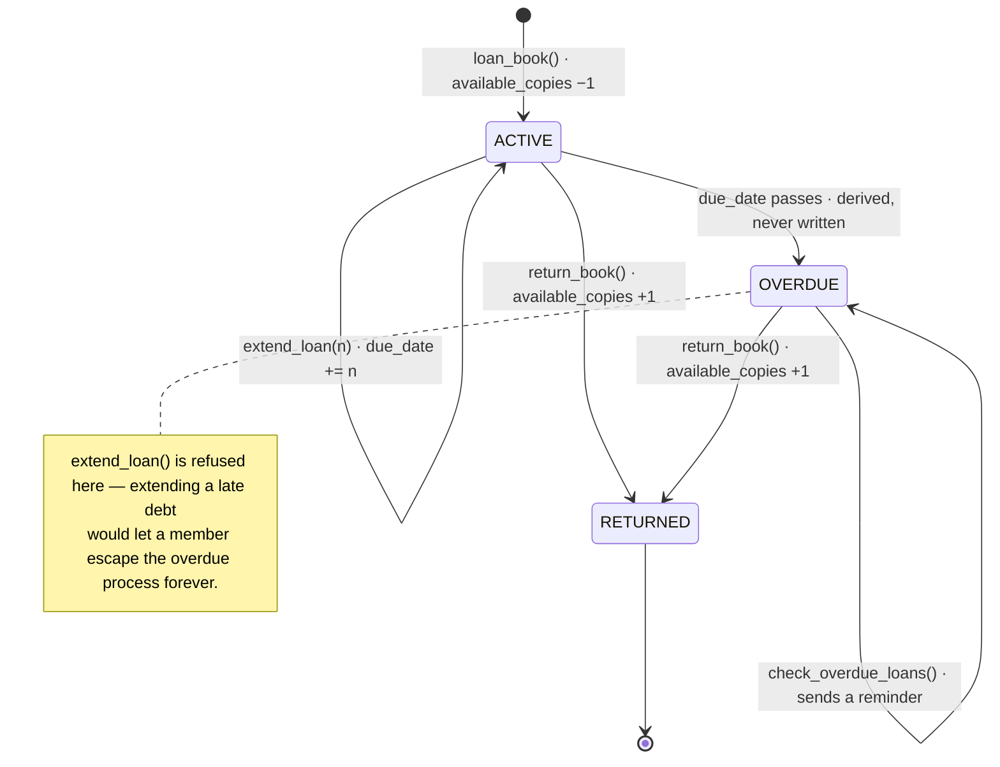
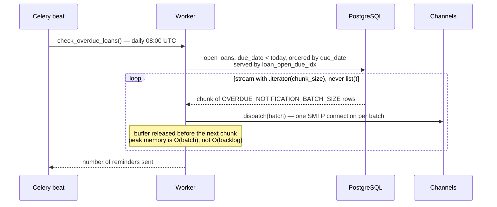

# Library Tracking System

A Django REST Framework service for a lending library — authors, books, members, loans —
where the loan lifecycle is the subject and the CRUD is incidental. Borrow, return,
extend, chase the late ones. Loan confirmations and the nightly overdue sweep run on
Celery with Redis as the broker. `docker compose up --build` starts PostgreSQL, Redis,
the API, a worker and beat, already migrated and seeded with loans in all three states.

## A loan has three states and only one of them is written down

`ACTIVE` and `OVERDUE` are both *open* loans, differing only in whether today is past
`due_date`, so `OVERDUE` is derived: `is_returned` is the single persisted fact about a loan's
lifecycle, `Loan.status` is a property over it and `due_date`, and `LoanQuerySet.overdue()` is
that predicate as a query. Nothing writes `OVERDUE` — a date passing causes it. Storing it
would buy a column, a job whose only purpose is keeping that column truthful, and a window
every day in which the database is lying.



The machine is declared as data rather than control flow — `ALLOWED_TRANSITIONS` and
`EXTENDABLE_STATUSES` in `library/services/loans.py` — so the rules can be read, and tested,
without tracing each function. Two edges are easy to get wrong and are pinned in
`library/tests/test_services.py`: **a loan due *today* is still extendable** (overdue is
`due_date < today`, strictly — off by one here is the difference between a fine and no fine),
and **returning closes the member's *oldest* open loan for that book**, since a member may
legally hold two copies of one title and `.get()` would raise `MultipleObjectsReturned` on a
perfectly valid state. The default loan period is `DEFAULT_LOAN_PERIOD_DAYS = 14`.

## Where the rules live

One direction only: **HTTP and Celery are adapters, `library/services/` owns the rules,
and the rules import nothing but the models.**

```
library/
  services/        loans.py (loan · return · extend · reserve), exceptions.py, notifications.py
  models.py        Author · Book · Member · Loan, plus LoanQuerySet and LoanStatus
  views.py         70 lines — parse, call a service, shape the response
  tasks.py         send_loan_notification and check_overdue_loans
  api_errors.py    DomainError → 400 {"error", "code"}
  notifications/   the channel seam — base.py, email.py, dispatch()
```

`services/` imports neither DRF nor Celery, which is why `test_services.py` can assert on
loan rules without constructing a request or starting a broker, and why the HTTP and Celery
callers cannot drift apart — they call the same functions.

Rule violations are a contract, not prose. Each raises a `DomainError` subclass and
`api_errors.domain_exception_handler` is the single place rendering one as
`400 {"error": ..., "code": ...}` — the message for the human at the desk, the code for a
client to branch on: `member_not_found`, `book_unavailable`, `no_active_loan`,
`loan_already_returned`, `loan_overdue`, `invalid_extension`. Adding a rule means adding an
exception class, not editing a view.

**Writes need credentials.** `IsAuthenticatedOrReadOnly` is the project-wide default in
`library_system/settings.py`; reads stay open so a reviewer can browse without logging in, and
`/health/` is the one deliberate `AllowAny` endpoint because the container healthcheck calls it.

**One extension seam**, the realistic one for a library ("can we also send SMS?"):
`NOTIFICATION_CHANNELS` lists dotted paths to `NotificationChannel` subclasses, so a channel
is one class implementing `deliver(notifications)` — taking a *list*, so batching is the
interface's default shape — plus one settings entry. Callers hand a `Notification` to
`dispatch()`; they never import a channel.

## The one operation that scales with history

Every endpoint costs what one request costs. `check_overdue_loans` costs what the
library's whole past costs, so it is the only place worth optimising.



`.only()` restricts the fetch to the five columns the templates and status derivation read, and
`loan_open_due_idx` on `(is_returned, due_date)` matches the predicate exactly, leading with
`is_returned` so closed loans — the bulk of a mature table — never enter the range scan.
`loan_book_open_idx` and `loan_member_open_idx` cover the return path and "what this member holds".

Two measurements, both taken locally against **SQLite** — the backend the test suite uses,
not the PostgreSQL the stack runs. The index shape is right for either engine, but read the
milliseconds as SQLite's, and note that no benchmark script is committed: these two tables are
the one part of this README you cannot re-run from the repo.

| Measured on SQLite | As shipped | The naive form |
|---|---|---|
| Peak memory sweeping 100,000 overdue loans (`tracemalloc`) | **0.7 MiB** in 14.8 s — `.iterator()`, flush per batch | **250.0 MiB** in 17.9 s — the same loop over `list(queryset)` |
| The overdue query at 200,000 loans, 1% overdue | **2.3 ms** — `SEARCH library_loan USING INDEX loan_open_due_idx` | **33.7 ms** — `SCAN library_loan` |

What the suite pins is behaviour, not those numbers: `test_streams_the_backlog_in_batches`
(the buffer never exceeds `batch_size`), `test_scan_is_a_single_query_regardless_of_row_count`,
`test_oldest_debts_are_notified_first`, and `assertNumQueries(2)` in `test_api_books.py` /
`test_api_loans.py` pinning the `select_related` joins so a serializer change that reintroduces
N+1 fails the build. List endpoints paginate (default 10, max 100) with a deterministic
`Meta.ordering` on every model, without which pages can repeat or skip rows. Deliberately
absent: caching, read replicas, sharding, Kubernetes.

## Boot it

```sh
docker compose up --build     # migrations applied, catalogue seeded, no second command
```

The DRF browsable API is at <http://localhost:8210/api/>, with `/health/` and `/admin/`
alongside it; PostgreSQL and Redis are on `localhost:8211` and `localhost:8212`. `seed_library`
writes 5 authors, 10 books, 5 members and 10 loans spanning all three states (three currently
overdue), a superuser `librarian` / `librarian`, and members `amara` `bo` `chen` `dalia` `evan`
with password `library-demo`. **Those are demo credentials** — set
`LIBRARIAN_PASSWORD` and `SEED_MEMBER_PASSWORD` before exposing the stack to anything. Email
goes to Django's console backend, so reminders appear in `docker compose logs worker` with no
SMTP server. Tear down with `docker compose down -v`.

```sh
curl -s 'http://localhost:8210/api/books/?page_size=3'                    # open to anonymous
curl -s -u librarian:librarian -X POST http://localhost:8210/api/books/1/loan/ \
     -H 'Content-Type: application/json' -d '{"member_id": 1}'

docker compose exec web python -c "from library_system.celery import app   # run the sweep now
print(app.send_task('library.tasks.check_overdue_loans').get(timeout=30))"
docker compose logs worker --since 60s
```

## What it answers

No UI to screenshot — this is a JSON API plus a worker — so the evidence is real
request/response pairs and worker logs captured against the running stack.
[`docs/api-session.md`](docs/api-session.md) holds the transcript: boot and seed, health,
anonymous browse, `403` on an anonymous write, a loan decrementing stock, the worker
delivering the confirmation, every error code, a return restoring stock, and the sweep — that
last being the capture to read:

```console
[2026-09-23 12:51:53,547: INFO/MainProcess] Task library.tasks.check_overdue_loans[6d74d82a] received
Subject: Overdue Book Loan
To: bo@example.com
"Ancillary Justice" was due on 2026-09-12 (11 day(s) ago). Please return it.
---------------------------------------------------------------------------
Subject: Overdue Book Loan
To: amara@example.com
"Stiff" was due on 2026-09-19 (4 day(s) ago). Please return it.
[2026-09-23 12:51:53,872: INFO/ForkPoolWorker-8] check_overdue_loans: sent 2 reminder(s)
```

The seed created **three** overdue loans and **two** reminders went out: the third was the copy
returned a few steps earlier in that same session — which is what derived overdue-ness buys, no
invalidation step and nowhere for a stale flag to hide. Reminders go oldest debt first (11 days
late before 4), because `LoanQuerySet.overdue()` orders by `due_date`.

## Running it locally

No PostgreSQL or Redis needed; SQLite is enough for the app and the tests.

```sh
python3 -m venv project_venv && ./project_venv/bin/pip install -r requirements-dev.txt
export DB_ENGINE=django.db.backends.sqlite3 DEBUG=1
./project_venv/bin/python manage.py migrate
./project_venv/bin/python manage.py seed_library      # the same demo data as Docker
./project_venv/bin/python manage.py runserver

# Celery still wants a broker: export CELERY_BROKER_URL=redis://localhost:6379/0, then
celery -A library_system worker -l info
celery -A library_system beat   -l info
```

The suite is Django's own runner — no extra dependencies, no services:

```console
$ DB_ENGINE=django.db.backends.sqlite3 DEBUG=1 python manage.py test
Ran 129 tests in 14.212s

OK
```

Also green: `ruff check .` → `All checks passed!`, `ruff format --check .` →
`44 files already formatted` (config in [`pyproject.toml`](pyproject.toml)), and
`manage.py makemigrations --check --dry-run` → `No changes detected`.

## Environment

Every setting comes from the environment; a gitignored `.env` in the project root is loaded
automatically and [`.env.example`](.env.example) lists them all. The ones that change behaviour
rather than just addresses:

| Variable | Default | Effect |
|---|---|---|
| `SECRET_KEY` | — | Required when `DEBUG=0`: startup raises `ImproperlyConfigured` without it. A throwaway key is used in debug only. |
| `OVERDUE_NOTIFICATION_BATCH_SIZE` | `500` | Rows the sweep buffers before flushing. This is what bounds its peak memory. |
| `RUN_MIGRATIONS` / `RUN_SEED` | `1` | Entrypoint switches. Worker and beat set both to `0`, so exactly one of the three containers sharing the image owns schema changes. |

## Container notes

Multi-stage `Dockerfile`: dependencies go into a venv in a builder stage which is copied into
a clean runtime, so pip, its cache and the build tooling never ship. Non-root `app` user,
static assets baked at build time and served by WhiteNoise, and `HEALTHCHECK` calls `/health/`,
which checks database connectivity rather than merely that the process is alive — Compose uses
those health states as dependency conditions, so `up` needs no `wait-for-it` loop. Beat's check
is `docker/healthcheck_beat.py`, a `/proc` scan and deliberately not `pgrep`: `procps` is
absent from `python:*-slim`, so a pgrep-based check reports the container unhealthy even while
beat runs perfectly. Each read is guarded, since a pid can vanish between `listdir` and `open`.

From this repo's own build report: **build verified — yes**, `docker compose build` exit 0,
image `library-tracking:local`, 341 MB; **boot verified — yes**, `docker compose up -d`, all
five services reached healthy on ports 8210 (API) / 8211 (PostgreSQL) / 8212 (Redis), real
requests served, a Celery task executed end to end and the overdue job run and observed —
the captured session above is from that boot. One caveat stated plainly: **the beat
healthcheck script is the single change in this repo never exercised inside Docker**, having
been written after the daemon was stopped. It compiles and `docker compose config -q`
parses, but it is reasoned-correct, not observed-correct.

## Known gaps

- **Authorisation is coarse.** `IsAuthenticatedOrReadOnly` means any authenticated user can
  act on any member's loans — no librarian-vs-member split, no "only your own loans", and
  session/HTTP-Basic auth only. The first thing to add for real use.
- **No fines, reservations, holds or renewal limits**, and no cap on extensions or on how
  many books one member may hold.
- **The sweep is not idempotent per day.** Run it twice and members get two reminders —
  nothing records that someone was chased. A `last_notified_at` column fixes it, and is a
  feature rather than a fix.
- **Only the email channel exists**, and there is no retry or backoff: a failed send is
  logged and lost.
- **Two paths to one outcome.** `POST /api/loans/` and `POST /api/books/{id}/loan/` both open
  a loan — the router gives the former for free — and both decrement stock, but one entry point
  would be cleaner.
