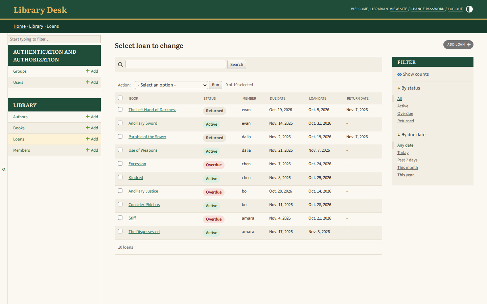
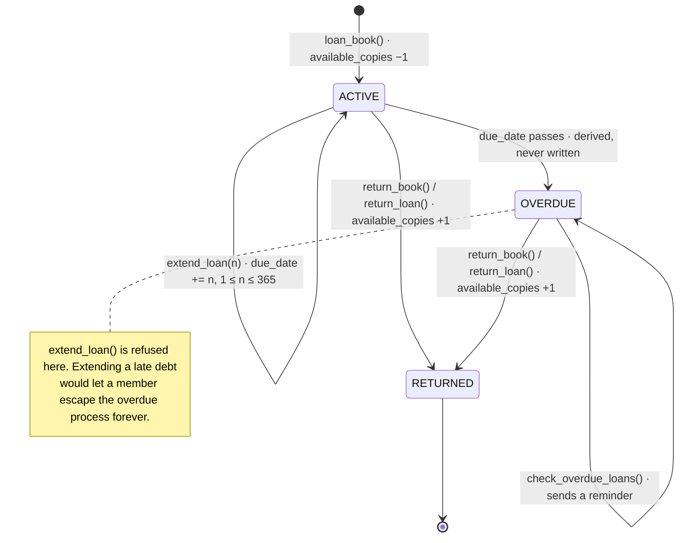
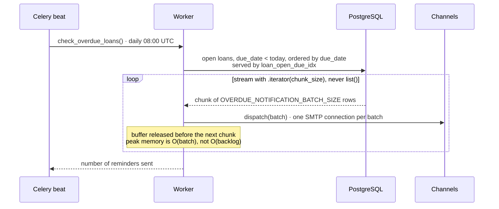
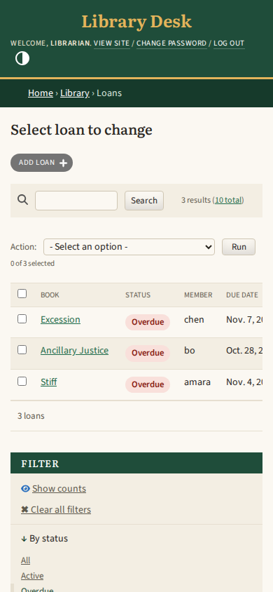
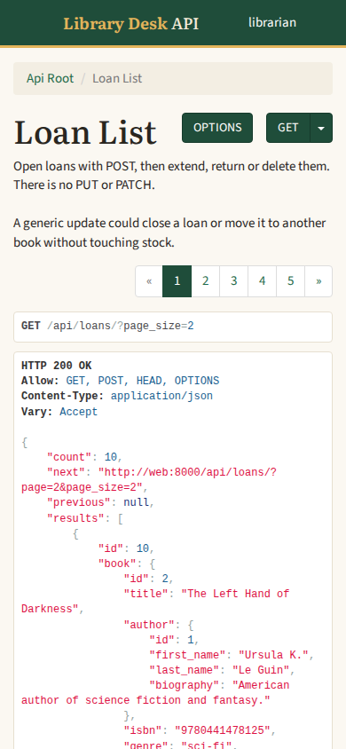

# Library Tracking System

A Django REST Framework service for a lending library: authors, books, members and loans.
The subject is the loan lifecycle, and the CRUD is incidental. Members borrow, return and
extend loans, and the late ones get chased. Loan confirmations and the nightly overdue sweep
run on Celery with Redis as the broker. Librarians get a re-dressed Django admin, the
*Library Desk*, that follows the same rules as the API.

`docker compose up --build` starts PostgreSQL, Redis, the API, a worker and beat. The stack
is already migrated and seeded with loans in all three states.



## A loan has three states and only one of them is written down

`ACTIVE` and `OVERDUE` are both *open* loans. The only difference is whether today is past
`due_date`, so `OVERDUE` is derived. `is_returned` is the single persisted fact about a loan's
lifecycle. `Loan.status` is a property over it and `due_date`, and `LoanQuerySet.overdue()` is
the same predicate as a query. Nothing writes `OVERDUE`: a date passing causes it. Storing it
would cost a column, a job whose only purpose is keeping that column truthful, and a window
every day in which the database is wrong.



The state machine is declared as data, not control flow: `ALLOWED_TRANSITIONS` and
`EXTENDABLE_STATUSES` in `library/services/loans.py`. That way the rules can be read and
tested without tracing each function. Two edges are easy to get wrong, and
`library/tests/test_services.py` pins both:

- **A loan due *today* can still be extended.** Overdue means `due_date < today`, strictly.
  An off-by-one here is the difference between a fine and no fine.
- **Returning closes the member's *oldest* open loan for that book.** A member may legally
  hold two copies of one title, and `.get()` would raise `MultipleObjectsReturned` on that
  perfectly valid state.

The default loan period is `DEFAULT_LOAN_PERIOD_DAYS = 14`. A caller may choose a due date
up to a year out, and one extension may add up to `MAX_EXTENSION_DAYS = 365`.

## Where the rules live

The dependency runs one way. **HTTP, Celery and the admin are adapters, `library/services/`
owns the rules, and the rules import nothing but the models.**

```
library/
  services/        loans.py (loan · return · extend · delete), exceptions.py, notifications.py
  models.py        Author · Book · Member · Loan, plus LoanQuerySet and LoanStatus
  views.py         parse the request, call a service, shape the response
  admin.py         the Library Desk: loans opened, returned and deleted via the service
  tasks.py         send_loan_notification and check_overdue_loans
  api_errors.py    DomainError → 400 {"error", "code"}
  notifications/   the channel seam: base.py, email.py, dispatch()
templates/         admin and browsable-API overrides; styles in library/static/library/
```

`services/` imports neither DRF nor Celery. That is why `test_services.py` can assert on loan
rules without building a request or starting a broker. It is also why the HTTP, admin and
Celery callers cannot drift apart: they all call the same functions.

Every way of changing a loan goes through that layer. `POST /api/loans/` and
`POST /api/books/{id}/loan/` both call `loan_book`, under a row lock, and both queue the
confirmation. `PUT` and `PATCH` on loans answer `405`, because a generic update could flip
`is_returned` or move a loan to another book without touching `available_copies`. `DELETE`
restocks an open loan first. The admin works the same way. A new loan is opened with
`loan_book`, and stock or due-date problems show up as form errors. Deletes go through
`delete_loan`. The lifecycle fields are read-only, and *Mark selected loans as returned*
calls `return_loan`.

Rule violations are a contract, not prose. Each one raises a `DomainError` subclass, and
`api_errors.domain_exception_handler` is the single place that renders it as
`400 {"error": ..., "code": ...}`. The message is for the person at the desk, and the code is
for a client to branch on:

- `member_not_found`
- `book_unavailable`
- `no_active_loan`
- `loan_already_returned`
- `loan_overdue`
- `invalid_extension`
- `additional_days_required`
- `additional_days_not_an_integer`
- `invalid_due_date`

Adding a rule means adding an exception class, not editing a view.

**Writes need credentials.** `IsAuthenticatedOrReadOnly` is the project-wide default in
`library_system/settings.py`. Reads stay open so a reviewer can browse without logging in.
`/health/` is the one deliberate `AllowAny` endpoint, because the container healthcheck
calls it.

**There is one extension seam**, the realistic one for a library ("can we also send SMS?").
`NOTIFICATION_CHANNELS` lists dotted paths to `NotificationChannel` subclasses. A new channel
is one class that implements `deliver(notifications)`, plus one settings entry. `deliver`
takes a *list*, so batching is the interface's default shape. Callers hand a `Notification`
to `dispatch()` and never import a channel.

## Endpoints

| Method and path | What it does |
|---|---|
| `GET /api/books/`, `/api/authors/`, `/api/members/`, `/api/loans/` | Paginated lists (`?page`, `?page_size` up to 100), open to anonymous readers |
| `POST/PUT/PATCH/DELETE` on books, authors, members | Plain CRUD for the catalogue and the member list |
| `POST /api/books/{id}/loan/` `{"member_id"}` | Opens a loan and takes a copy off the shelf |
| `POST /api/books/{id}/return_book/` `{"member_id"}` | Closes that member's oldest open loan for the book |
| `POST /api/loans/` `{"book_id", "member_id", "due_date"?}` | Opens a loan, with the same rules as the book action |
| `POST /api/loans/{id}/extend_due_date/` `{"additional_days"}` | Extends an active loan by 1 to 365 days |
| `POST /api/loans/{id}/return/` | Closes that specific loan and restocks the copy |
| `DELETE /api/loans/{id}/` | Removes the record, restocking first if the loan was open |
| `GET /health/` | `{"status": "ok", "database": "ok"}`, or `503` when the database is unreachable |

## The one operation that scales with history

Every endpoint costs what one request costs. `check_overdue_loans` costs what the library's
whole past costs, so it is the only place worth optimising.



`.only()` limits the fetch to the five columns that the templates and the status derivation
read. `loan_open_due_idx` on `(is_returned, due_date)` matches the predicate exactly. It leads
with `is_returned`, so closed loans, which are the bulk of a mature table, never enter the
range scan. `loan_book_open_idx` and `loan_member_open_idx` cover the return path and "what
this member holds".

Both measurements below were taken locally against **SQLite**, the backend the test suite
uses, not the PostgreSQL the stack runs. The index shape is right for either engine, but the
milliseconds are SQLite's. No benchmark script is committed, so these are the one part of
this README that you cannot re-run from the repo.

| Measured on SQLite | As shipped | The naive form |
|---|---|---|
| Peak memory sweeping 100,000 overdue loans (`tracemalloc`) | **0.7 MiB** in 14.8 s, with `.iterator()` and a flush per batch | **250.0 MiB** in 17.9 s, with the same loop over `list(queryset)` |
| The overdue query at 200,000 loans, 1% overdue | **2.3 ms**: `SEARCH library_loan USING INDEX loan_open_due_idx` | **33.7 ms**: `SCAN library_loan` |

The suite pins behaviour, not those numbers:

- `test_streams_the_backlog_in_batches`: the buffer never exceeds `batch_size`.
- `test_scan_is_a_single_query_regardless_of_row_count`.
- `test_oldest_debts_are_notified_first`.
- `assertNumQueries(2)` in `test_api_books.py` and `test_api_loans.py`: it pins the
  `select_related` joins, so a serializer change that brings back N+1 queries fails the
  build.

List endpoints paginate (default 10, max 100), and every model has a deterministic
`Meta.ordering`. Without one, pages can repeat or skip rows. Caching, read replicas, sharding
and Kubernetes are deliberately absent.

## Boot it

```sh
cp .env.example .env          # optional: every value already has a default in Compose
docker compose up --build     # migrations applied, catalogue seeded, no second command
```

| Address | What is there |
|---|---|
| <http://localhost:8210/admin/> | The Library Desk admin |
| <http://localhost:8210/api/> | The DRF browsable API |
| <http://localhost:8210/health/> | The health probe |
| `localhost:8211` / `localhost:8212` | PostgreSQL 17 and Redis 7 |

`seed_library` writes 5 authors, 10 books, 5 members and 10 loans, covering all three states
(three are overdue). It also creates the superuser `librarian` / `librarian`, and members
`amara`, `bo`, `chen`, `dalia` and `evan` with the password `library-demo`.

**Those are demo credentials,** as are the database password and the Compose `SECRET_KEY`.
Set `LIBRARIAN_PASSWORD`, `SEED_MEMBER_PASSWORD`, `POSTGRES_PASSWORD` and `SECRET_KEY`
before you expose the stack to anything.

Email goes to Django's console backend, so reminders appear in `docker compose logs worker`
and no SMTP server is needed. Tear down with `docker compose down -v`. A `postgres_data`
volume left over from an older PostgreSQL 16 stack will not start under 17, so remove it with
`docker compose down -v` first.

```sh
curl -s 'http://localhost:8210/api/books/?page_size=3'                    # open to anonymous
curl -s -u librarian:librarian -X POST http://localhost:8210/api/books/1/loan/ \
     -H 'Content-Type: application/json' -d '{"member_id": 1}'

docker compose exec web python -c "from library_system.celery import app   # run the sweep now
print(app.send_task('library.tasks.check_overdue_loans').get(timeout=30))"
docker compose logs worker --since 60s
```

## What it looks like

The admin and the browsable API share one look: deep library green with a brass rule,
Literata headings over Source Sans 3, and a matching dark scheme. Loan status is a badge
that carries its label as text, so it does not rely on colour alone. The *status* filter
works on the derived state, even though there is no column behind it.

| Overdue loans on a phone | The browsable API on a phone |
|---|---|
|  |  |

More captures in [`docs/screenshots/`](docs/screenshots/): the sign-in page, the full loan
list on a phone, and the browsable API on a desktop. All of them use the seed data.

## What it answers

[`docs/api-session.md`](docs/api-session.md) holds real request/response pairs and worker
logs, captured against the running stack. They cover:

- boot and seed
- the health check
- anonymous browsing, and the `403` on an anonymous write
- a loan decrementing stock, and the worker delivering the confirmation
- every error code
- the `405` on `PATCH`, and a return restoring stock
- the overdue sweep

The sweep is the capture to read:

```console
[2026-11-08 02:19:07,337: INFO/MainProcess] Task library.tasks.check_overdue_loans[e7dcec2a-...] received
Subject: Overdue Book Loan
To: bo@example.com
"Ancillary Justice" was due on 2026-10-28 (11 day(s) ago). Please return it.
-------------------------------------------------------------------------------
Subject: Overdue Book Loan
To: amara@example.com
"Stiff" was due on 2026-11-04 (4 day(s) ago). Please return it.
[2026-11-08 02:19:07,347: INFO/ForkPoolWorker-8] check_overdue_loans: sent 2 reminder(s)
```

The seed created **three** overdue loans, but only **two** reminders went out. The third was
the copy returned earlier in the same session. That is what derived overdue-ness buys: there
is no invalidation step and nowhere for a stale flag to hide. Reminders go oldest debt first
(11 days late before 4), because `LoanQuerySet.overdue()` orders by `due_date`.

## Running it locally

The app and the tests need no PostgreSQL or Redis; SQLite is enough. Use Python 3.12
(see `.python-version`).

```sh
python3.12 -m venv project_venv && ./project_venv/bin/pip install -r requirements-dev.txt
export DB_ENGINE=django.db.backends.sqlite3 DEBUG=1
./project_venv/bin/python manage.py migrate
./project_venv/bin/python manage.py seed_library      # the same demo data as Docker
./project_venv/bin/python manage.py runserver

# Celery still wants a broker: export CELERY_BROKER_URL=redis://localhost:6379/0, then
./project_venv/bin/celery -A library_system worker -l info
./project_venv/bin/celery -A library_system beat   -l info
```

The suite uses Django's own runner, with no extra dependencies and no services:

```console
$ DB_ENGINE=django.db.backends.sqlite3 DEBUG=1 python manage.py test
Ran 156 tests in 50.211s

OK
```

These also pass:

- `ruff check .` → `All checks passed!`
- `ruff format --check .` → `41 files already formatted` (config in
  [`pyproject.toml`](pyproject.toml))
- `manage.py makemigrations --check --dry-run` → `No changes detected`

The stack is Django 6.1, DRF 3.18, Celery 5.7 with the Redis extra, and gunicorn 26.

## Environment

Every setting comes from the environment. A gitignored `.env` in the project root is loaded
automatically, and [`.env.example`](.env.example) lists every variable. These are the ones
that change behaviour rather than just addresses:

| Variable | Default | Effect |
|---|---|---|
| `SECRET_KEY` | none | Required when `DEBUG=0`: startup raises `ImproperlyConfigured` without it. A throwaway key is used in debug only. |
| `OVERDUE_NOTIFICATION_BATCH_SIZE` | `500` | Rows the sweep buffers before flushing. This is what bounds its peak memory. |
| `RUN_MIGRATIONS` / `RUN_SEED` | `1` | Entrypoint switches. Worker and beat set both to `0`, so only one of the three containers sharing the image owns schema changes. |

## Container notes

The `Dockerfile` is multi-stage. Dependencies are installed into a venv in a builder stage,
and that venv is copied into a clean runtime, so pip, its cache and the build tooling never
ship.

- The runtime runs as a non-root `app` user.
- Static assets, including the admin and API styling, are baked in at build time and served
  by WhiteNoise.
- `HEALTHCHECK` calls `/health/`, which checks the database connection rather than just that
  the process is alive. Compose uses those health states as dependency conditions, so `up`
  needs no `wait-for-it` loop.
- Beat's healthcheck is `docker/healthcheck_beat.py`, a `/proc` scan. It deliberately avoids
  `pgrep`: `procps` is missing from `python:*-slim`, so a pgrep-based check would report the
  container unhealthy even while beat runs fine. Each read is guarded, because a pid can
  vanish between `listdir` and `open`.

From a clean checkout, `docker compose up --build` produced a 359 MB `library-tracking:local`
image, and all five services reached `healthy`, beat included. The session in
`docs/api-session.md` was recorded from that boot.

## Known gaps

- **Authorisation is coarse.** With `IsAuthenticatedOrReadOnly`, any authenticated user can
  act on any member's loans. There is no librarian-versus-member split and no "only your own
  loans" rule, and auth is session or HTTP Basic only. This is the first thing to add for
  real use.
- **No fines, reservations, holds or renewal limits.** One extension is capped at 365 days,
  but nothing limits how many extensions a loan gets or how many books one member may hold.
- **The admin's due-date field is a librarian override.** Editing it directly skips the
  "no extending an overdue loan" rule. That is deliberate for corrections, but the change
  is not recorded anywhere.
- **The sweep is not idempotent per day.** Run it twice and members get two reminders,
  because nothing records that someone was chased. A `last_notified_at` column would fix it,
  and that is a feature rather than a fix.
- **Only the email channel exists**, and there is no retry or backoff. A failed send is
  logged and lost.

## License

[MIT](LICENSE).
